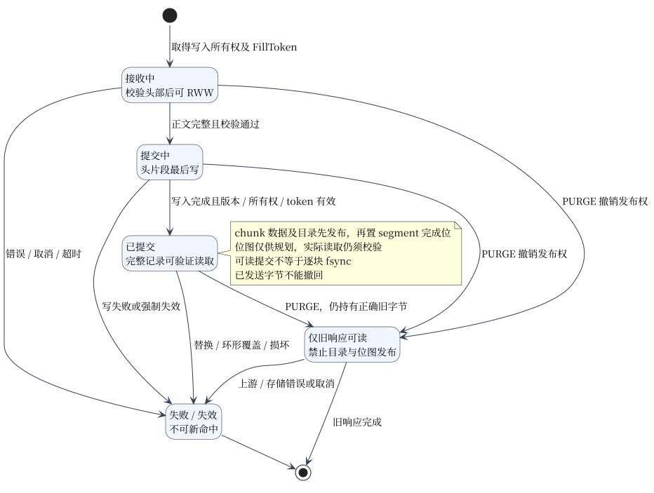

# 磁盘格式与恢复

允许崩溃后安全 MISS；不承诺数据库级持久性或 ATS 磁盘格式兼容。启动日志记录 clean/cold、检查点版本和恢复耗时。

## 发布状态

下图描述缓存块的运行时发布状态，不是代码中的枚举。验证源站响应头后，已接收的字节即可供 RWW 读者使用；客户端可先完成自身响应，已经开始的当前块继续独立填充。块完整且校验通过后，先发布数据目录，再发布 segment 完成位；后续失败不会追溯改变已完成响应，但失败块不发布。对象信息与 segment 位图也使用现有缓存记录，不引入独立 manifest 文件。



## 格式

| 层 | 版本与约束 |
| --- | --- |
| Stripe marker | v2；原 24 B 保留区保存 magic、版本、随机 16 B session；数据区偏移不变 |
| Doc | v3；72 B 头；IEEE CRC32 覆盖 checksum 置零的序列化头、元数据、正文 |
| 片段身份 | 完整逻辑键/首键摘要、writer、片段位置和长度独立校验；非头 TotalLen 为逻辑结束偏移，头为总长 |
| Checkpoint | v1；`<data path>.<Skip>.checkpoint`；带校验的 geometry、写位置、phase、session、目录、完整键/selector |
| 部分对象记录 | v3；对象、segment、chunk 使用独立键；固定 1 MiB/chunk、64 chunk/segment；对象版本、缓存代次、块位置和有效长度参与数据身份 |
| 编码 | 目录字段小端；envelope/字符串长度大端；每条映射编码额外至多 8 B |
| 限额 | 每键/selector 16 KiB；至多 min(65,536, 目录容量) 条；键/selector 字符串合计 16 MiB |
| 不兼容/损坏 | missing/dirty/torn/geometry/session 不符均冷 MISS；不扫描旧数据重建、不在线迁移 |

## 打开与关闭

| 顺序 | 操作 |
| --- | --- |
| Open 1 | 独占底层 inode；同进程可用不重叠 split stripe，不同进程连不重叠区域也不能共享 |
| Open 2 | 仅载入 session/geometry 匹配的 clean 检查点；先校验长度/索引/链表环，再验证对象全部片段与元数据；仅恢复完整对象，坏项 MISS |
| Open 3 | 暴露访问前写入并 sync 新随机 session；失败则 Open 失败，硬链接/别名也无法复用旧检查点 |
| Running Save | sync 数据并发布 dirty 检查点；当前活动会话不能据此恢复 HIT |
| Close | 阻止新工作/PURGE，终止活跃写者，停止 evacuation，排空磁盘写；发布锁下快照目录/键映射 |
| Close 提交 | sync 数据 → 写/sync 临时 clean 检查点 → 原子 rename → sync 父目录 |

只读访问也可能触发 evacuation，因此也更新 session。split stripe 的文件锁在最后一个 stripe 关闭后才释放。Open 不删除/截断原文件；后续正常环写仍会复用空间。

## 读者与覆盖

读盘/迁移按有界 fragment 长度分配，不按整对象 TotalLen 分配。读者可继续使用已验证字节；后续片段覆盖、替换、损坏或缺失须报错。目录发布复核所有权、allocation generation 和 PURGE 代次。

重开时 Stripe 与聚合写使用同一进程内 allocation generation，保留可表示的前一代，允许旧 phase 对象继续正确失效、刷新和迁移；不改变检查点格式。迁移机制见 [evacuation](evacuation.md)。

## 部分对象恢复

各 stripe 独立保存，未增加跨 stripe 事务。对象信息或 segment 成功恢复，不保证另一 stripe 上的 chunk 也已可靠保存：完成位只是规划提示，读取仍校验实际目录、记录身份、长度和 CRC。数据保存失败时，缺块成为 MISS，经条件修复和补块后才能重新使用；不能仅凭恢复的位图返回内容。

正常关闭后，稀疏 Range 的已完成块和普通 GET 的分块数据均可复用。异常退出由持久化 session 隔离旧检查点，无法证明一致的 stripe 可以整体冷启动。PURGE 后仍在发送的私有旧流不进入目录或位图；即使它晚于新代次结束，也不能通过检查点重新发布。

| 验收 | 可观察结果 |
| --- | --- |
| 跨 stripe 数据 Sync 失败 | Close 返回 EIO；另一 stripe 的位图即使恢复，未保存的 chunk 仍为 MISS；修复补块后可靠重启可读 |
| chunk/bitmap/保存窗口强杀 | 数据写入前、部分数据写入、chunk 发布、部分位图写入、位图发布、数据 Sync 后检查点发布前均安全 MISS；可靠 Close 对照保留正确数据 |
| checkpoint Rename 失败 | Close 返回错误，其他 stripe 仍完成关闭；临时文件清理，失败 stripe 重开不伪造命中 |
| 格式与文件作用域 | 不兼容对象版本、块布局、segment 版本及旧 namespace 被拒绝；业务文件、无关 sidecar、独立缓存的原始字节保持不变 |
| 真实进程重启 | 验证状态、响应头、正文 SHA 和源站正文计数；正常重启复用稀疏块，缺块单独回源；强杀或 PURGE 后重建不复活旧代次 |

复现入口：

```sh
go test -race ./cache -run 'TestPartialRecovery|TestPartialCheckpoint' -count=1
go build -o /tmp/razor-recovery .
RAZOR_ACCEPTANCE_BINARY=/tmp/razor-recovery python3 -m unittest discover -s tools -p 'partial_recovery_test.py' -v
```

验证代码：[部分对象恢复](../cache/partial_recovery_test.go)、[进程 HTTP 恢复](../tools/partial_recovery_test.py)、[提交/回卷](../cache/storage_commit_test.go)、[恢复/损坏/子进程强杀](../cache/recovery_test.go)、[PURGE 后强杀](../cache/invalidation_restart_test.go)。数据及位图短写、EIO、ENOSPC 和数据 Sync、checkpoint Rename 失败已有确定性验证；未分别注入临时检查点文件 Sync、父目录 Sync 或物理断电，不将进程强杀等同于这些故障。
