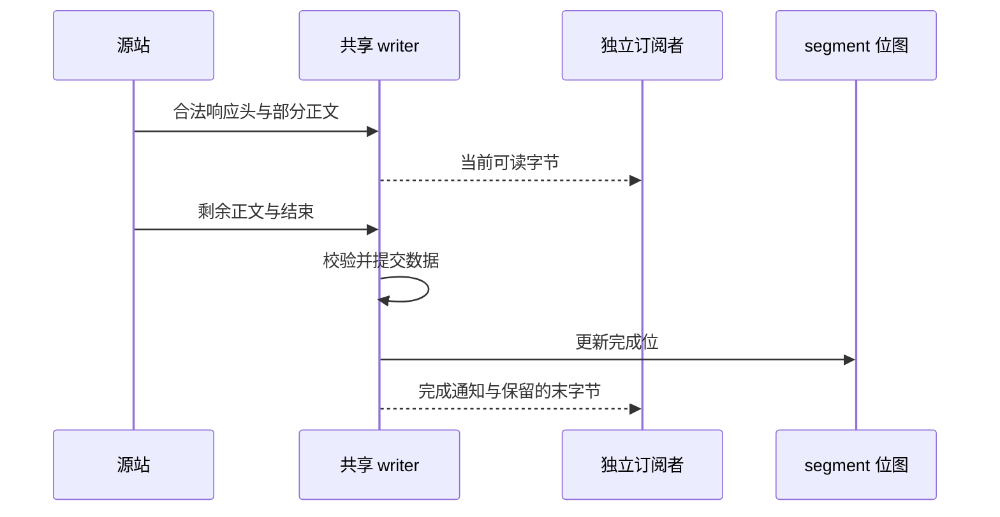

# 块内 RWW 与完整块发布

响应头中的范围、强 ETag、长度及共享准入通过后，**当前 chunk 尚未收齐即可读取已到达的字节**。只有完整校验、数据提交和目录发布后，才置完成位。 共享身份见 [缓存填充设计](cache_fill_design.md)。

## 管线时序



| 路径 | 开始发送 | 响应 |
| --- | --- | --- |
| 普通整对象 MISS | 共享头部通过准入后 | 200 |
| 合格单 Range | 对齐响应头校验后，目标偏移已有字节时 | 206 |
| 合格公共大 GET | 首块响应头校验后 | 200 |
| 不可缓存/不支持 | 普通代理语义；不等于缓存 RWW | 由源站决定 |

大 GET 要求公共模式，长度大于 `max(1 MiB, 块大小)`；块路径要求 HEAD、总长、强 ETag、identity。fresh 整对象和小对象保留原路径。

## 提交与资源

| 阶段 | 保证 |
| --- | --- |
| 接收 | 先确认精确区间/ETag/长度/编码与无 Trailer，再经共享 writer 输出在途字节 |
| 提交 | 复用 CacheVC/cacheFill；一个块可含多个 fragment，头片段最后写；CRC、所有权和失效围栏均有效 |
| 发送 | 完成位规划命中；命中读取仍校验，缺块订阅绑定确切 writer；按客户端独立偏移裁剪 |
| 背压 | 写者和读者各有额度；生产者独立于客户端，最后订阅者取消时停止回源 |
| 淘汰 | 已准备块并非永久 pinned；丢失后按原 token、源站、ETag 受控补块；独立校验字节可完成当前发送 |

写者槽数为 `min(max_writers, write_buffer_bytes / CacheWriterReservation())`；读者另有限额。预算包含块、fragment、元数据等，磁盘只需必要窗口；不等于“两个块”或进程 RSS 上限。[发送缓冲预算](ram_cache.md#http-发送缓冲)另计。

## 失败边界

| 事件 | 行为 |
| --- | --- |
| 头发送前失败 | 按错误返回 5xx 或安全旁路；所有权冲突不能用旁路重复生产 |
| 头发送后失败 | 后续块错误、已知版本变化、PURGE 失效：中断 HTTP 响应/H2 流，不追加错误正文或换版本拼接 |
| 取消 | 释放本请求的确切订阅；其他订阅者继续，无剩余需求则取消生产者 |
| 客户端条件请求 / 非法区间 | 透传 / 416 |
| 下游缓存 | 合成 200/206 使用 Cache-Control: no-cache；内部逐块判断 freshness |

每块发送前检查失效；已发/网络缓冲字节不可撤回。对象元数据被淘汰只表示版本未知，不直接视为换版；后续补块仍受强 ETag 约束。提交不等于逐块 fsync，恢复边界见 [存储文档](cache_storage_format.md)。HTTP RWW 通过 CacheVC.OpenReader 绑定确切 writer，旧订阅的关闭不会移除同 key 新任务。

每个请求范围在本块的最后一个字节等待完整验证与完成位发布，避免客户端读满 Content-Length 后正常断开取消对齐填充。普通范围仍提前输出前缀；只有一个字节的范围没有可提前发送的前缀，需等本块验证完成。

## 配置与回归

Plan A 固定每个 chunk 为 1 MiB、每个 segment 包含 64 个 chunk。兼容配置项 `proxy.config.cache.range_block_bytes` 仅接受 1048576；其他值拒绝加载。

代码：[serveBlocks](../server/range_cache.go)。回归：[首块屏障/共享](../server/rww_test.go)、[淘汰](../server/rww_eviction_test.go)、[版本围栏](../server/range_version_fence_test.go)。

```bash
go test ./server -run 'Test(RangeCommittedBlockArrivesBeforeSecondBlock|PublicGETCommittedBlockArrivesBeforeSecondBlock|PublicGETAndOverlappingRangeShareBlockProducers|RangeOnlyFetchesMissingAlignedUnion|CommittedBlockStreamAbortsOnLaterOriginFailure)$' -count=1 -timeout 120s
```
