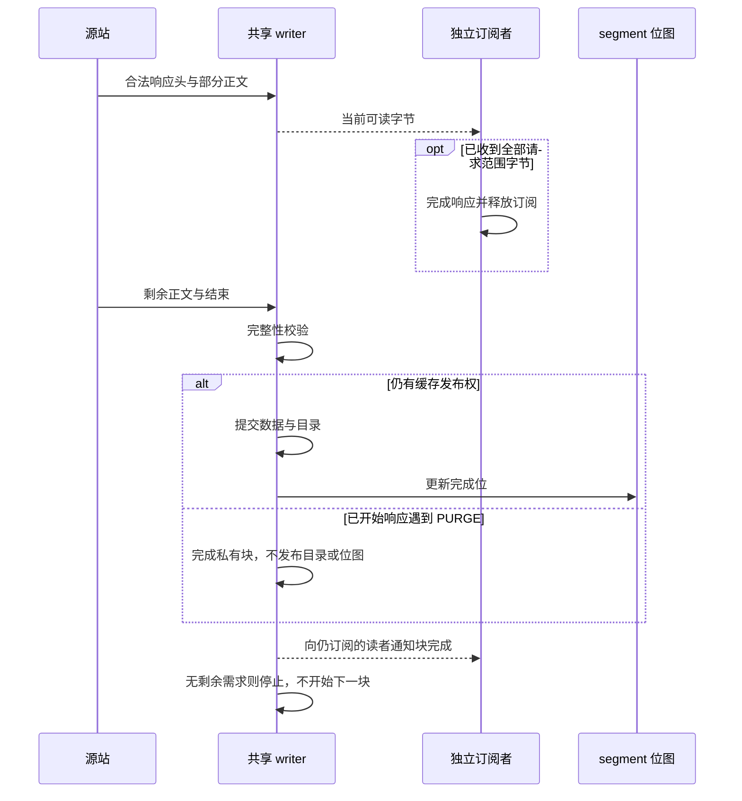

# 块内 RWW 与完整块发布

响应头中的范围、强 ETag、长度及共享准入通过后，**当前 chunk 尚未收齐即可读取已到达的字节**，客户端所需字节到齐即可结束响应。当前块的填充独立完成；只有完整校验、数据提交和目录发布后，才置完成位。共享身份见 [缓存填充设计](cache_fill_design.md)。

## 管线时序



| 路径 | 开始发送 | 响应 |
| --- | --- | --- |
| 普通整对象 MISS | 共享头部通过准入后 | 200 |
| 合格单 Range | 对齐响应头校验后，目标偏移已有字节时 | 206 |
| 合格普通 GET | 普通响应头或缺块响应头校验后 | 200 |
| 不可缓存/不支持 | 普通代理语义；不等于缓存 RWW | 由源站决定 |

分块路径要求已知总长、强 ETag 和 identity。完全冷 GET 从一次普通 GET 响应发现这些前提，不先 HEAD；小对象也复用分块路径。Range 冷启动通过共享 HEAD 发现。普通 GET 与 Range 共享发现任务和块 writer，6 KiB 等不足整块的已到达字节也可发送；单字节 Range 同样可以在整块完成前结束响应，不保留末字节。不符合分块前提的 GET 使用同一源响应保留既有整对象或透传行为。

## 提交与资源

| 阶段 | 保证 |
| --- | --- |
| 接收 | 先确认精确区间/ETag/长度/编码与无 Trailer，再经共享 writer 输出在途字节 |
| 提交 | 复用 CacheVC/cacheFill；当前 1 MiB chunk 的正文对应一个 Doc fragment，末块可短；CRC、所有权和发布权围栏均有效。普通整对象仍可含多个 fragment，头片段最后写 |
| 发送 | 完成位规划命中；命中读取仍校验，缺块订阅绑定确切 writer；按客户端独立偏移裁剪 |
| 背压 | 写者和读者各有额度；最后订阅者离开后仅完成已开始的当前 chunk，不继续下一块 |
| 淘汰 | 已准备块并非永久 pinned；丢失后按原 token、源站、ETag 受控补块；独立校验字节可完成当前发送 |

写者槽数为 `min(max_writers, write_buffer_bytes / CacheWriterReservation())`；读者另有限额。预算包含块、fragment、元数据等，磁盘只需必要窗口；不等于“两个块”或进程 RSS 上限。[发送缓冲预算](ram_cache.md#http-发送缓冲)另计。

响应头校验后，生产者在当前块开始处原子检查仍有订阅者，再进入该块的独立填充；这一范围包括等待已有写者额度。最后读者离开与下一块开始使用同一同步边界，因此不会把无人需要的下一块当作当前块继续。当前块完成前，等价请求仍可加入原在途任务；`SharedFillTasks > 0` 且 `SharedFillWaiters = 0` 可以短暂出现。任务期限不重置，服务关闭和存储失败仍可提前终止，不能无限等待慢源站。

## 失败边界

| 事件 | 行为 |
| --- | --- |
| 头发送前失败 | 按错误返回 5xx 或安全旁路；所有权冲突不能用旁路重复生产 |
| 响应未完成时失败 | 仍缺少所需字节的读者中断 HTTP 响应/H2 流，不追加错误正文或换版本拼接 |
| 响应完成后的尾部失败 | 客户端成功无法撤回；对齐填充的失败块不发布，仍缺少所需字节的其他读者接收错误 |
| 取消 | 释放本请求的确切订阅；其他订阅者继续；无人需要时仅完成已开始的当前 chunk，没有已开始块则立即取消 |
| 客户端条件请求 / 非法区间 | 透传 / 416 |
| 下游缓存 | 合成 200/206 使用 Cache-Control: no-cache；内部逐块判断 freshness |

每块发送前检查失效；仅已开始响应的 PURGE 发布权撤销允许继续，存储失败、关闭及其他强制失效仍失败。已发/网络缓冲字节不可撤回。对象元数据被淘汰只表示版本未知；发现新版元数据也不会中断仍可获得的旧版本字节。后续补块始终约束已选强 ETag，无法取得则失败，本次请求不换版重试。提交不等于逐块 fsync，恢复边界见 [存储文档](cache_storage_format.md)。HTTP RWW 通过 CacheVC.OpenReader 绑定确切 writer，旧订阅的关闭不会移除同 key 新任务。

请求只等待自身范围的字节，不把当前块完成通知作为响应结束屏障。正常完成或断开后，生产者独立读取当前块剩余的对齐字节并校验；没有其他需求时，完成该块后释放源响应及任务，不启动下一块。PURGE 后的旧私有填充仍不得发布目录或完成位。该边界由 [2026-11-03 ADR 澄清](adr/0001-partial-object-caching-plan-a.md#2026-11-03响应完成与当前块填充分开)记录。

连续缺块最多以两个 chunk 合并为一次 Range 回源；每个 chunk 有独立就绪和完成通知，因此首块不会等待下一块。即使源请求覆盖两个 chunk，无需求时也只读取已经开始的当前块，再关闭剩余源响应；普通 GET 同样不会在无人需要时继续下载整对象。客户端始终按对象绝对偏移裁剪，segment 边界分开规划。头部通过准入后显式发送响应头，再读取可能失败的在途正文，避免复用连接上的客户端把未发送头的中断误判为可自动重试的请求。

## 配置与回归

Plan A 固定每个 chunk 为 1 MiB、每个 segment 包含 64 个 chunk。兼容配置项 `proxy.config.cache.range_block_bytes` 仅接受 1048576；其他值拒绝加载。

代码：[serveBlocks](../server/range_cache.go)、[位图与区间规划](../server/range_plan.go)。回归：[块内 RWW 与失败](../server/partial_chunk_test.go)、[GET/Range 双向共享](../server/partial_get_test.go)、[跨块/segment/取消](../server/partial_range_test.go)、[PURGE 续流与私有共享](../server/partial_purge_test.go)、[淘汰](../server/rww_eviction_test.go)、[版本围栏](../server/range_version_fence_test.go)。

```bash
go test ./server -run 'Test(ColdGETStreamsOnceAndFeedsRangeCache|GETReusesInFlightRangeAndOnlyFetchesRemainingChunks|RangeOnlyFetchesMissingAlignedUnion|PartialPurgeKeepsStartedResponseAndSeparatesNewGeneration|PartialPurgeOldRangeVersionFailureDoesNotRetryOrRetireNew|PartialPurgeOldCursorsShareSubsequentPrivateRun)$' -count=1 -timeout 120s
```

PURGE 后的私有块继续使用 `CacheVC.OpenReader`，每个 writer 最多 1 MiB；普通 GET 仅持当前 slot，Range run 最多两个 slot。完成 writer 的当前块字节保留到确切 reader/slot 释放，旧 reader 不会读到同 key replacement。后续未启动的 run 可以按原 ETag 私有回源；已经开始的旧响应仍共享同一旧代次、相容身份的重叠在途区间，新请求不能加入。若旧版本不可取得，响应异常结束且不重试为新版。

私有续流不保存整对象历史。慢读者所需的已完成旧块若已离开有界窗口且缓存不可读，可受控补取一次同版本单块；这会增加 PURGE 后的回源字节，不能将有界内存等同于零额外回源。
